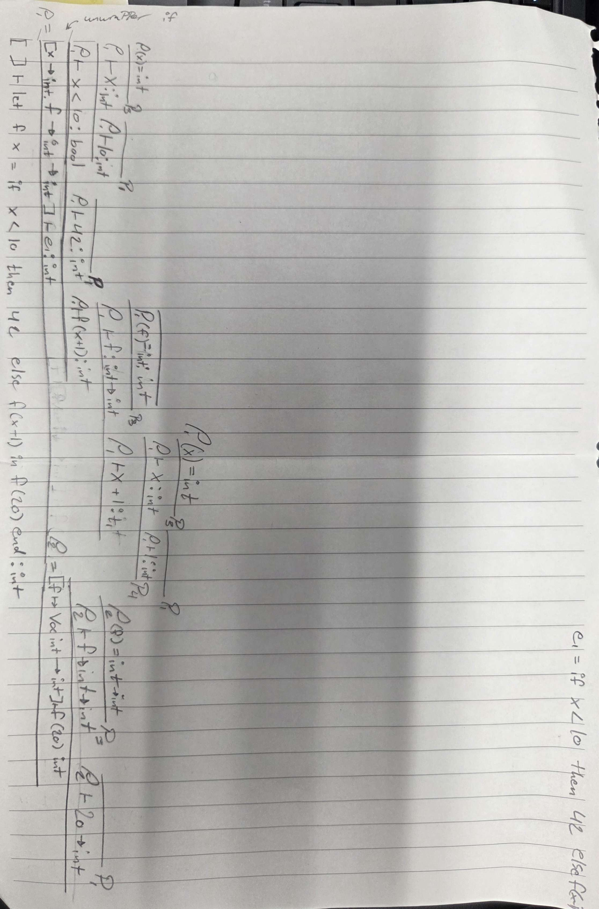

# Assignment 5
## Exercise 6.4
### (i)
The hard to spot $e_1$ in the top right corner reads:
```
e_1 = if x < 10 then 42 else f(x-1)
```


### (ii)
If we have a value with no type, when we've completed the truth tree, the tree must be polymorphic.

Since every type is infered/known in our tree, it must be monomorphic.

## Exercise 6.5
For each of the functions here are the results we've found.

**ex01**  
`let f x = 1 in f f end`  
Type is an `int`.

**ex02**  
`let f g = g g in f end`  
Type could not be infered.

g g is not typable because g must simultaniously be a function AND an argument to itself. This produces a circular type equation `'a` = `'a` -> `'b` where no finite type exists.

The equation `'a` = `'a` -> `'b` cannot be solved using ordinary finite types because defining 'a requires 'a to already appear inside its own definition.

**ex03**  
`let f x = let g y = y in g false end in f 42 end`  
Type is a `bool`.

**ex04**  
`let f x = let g y = if true then y else x in g false end in f 42 end`  
Type could not be infered.  
Expected `bool`, but received `int`.

`g` is called with false, so y has type `bool`. both branches of the `if` statement must have the same type, so `x` needs to be a `bool`. Therefore, `f` gas type `bool -> bool` but is called with an `int` which is `42` which results in an error.

**ex05**  
`let f x = let g y = if true then y else x in g false end in f true end`
Type is a `bool`.

### (ii)

`bool -> bool`
let f x =   
if x then true else false   
in f end

`int -> int`  
let f x = x + 1  
in f end

`int -> int  -> int`  
let f x y = x + y  
in f end

`'a -> 'b -> 'a`   
let f x g = x  
in f end  

`'a -> 'b -> 'b`  
let f x g = g  
in f end

`('a -> b') ('b -> 'c) ('a -> 'c)`  
let compose f g x =  
    g (f x)  
in compose end

```fsharp
//This block is a more intricate but more explicit way to write the previous statement.
let compose f g x = g (f x)
in
    let addOne x = x + 1
    in
        let double x = x * 2
        in compose addOne double 3
        end
    end
end
```

This is some weird stuff.. because of nontermination, if i create a function which recurses forever, then it can technically take any type, and promise to return any other type. Because it never actually returns anything...  
`'a -> 'b`  
let f x = f x  
in f end  

okay so now we give the function a parameter 0. which is never used, sure, but we now know the input. but since we have an unbound variable which previously was 'b, because 'a has been freed up, 'a is now used as the return type. again, weird stuff...  
`'a`  
let f x = f x  
in f 0 end  

## Exercise 7.1

```fsharp
val it: Absyn.program =
  Prog
    [Fundec
       (None, "main", [(TypI, "n")],
        Block
          [Stmt
             (While
                (Prim2 (">", Access (AccVar "n"), CstI 0),
                 Block
                   [Stmt (Expr (Prim1 ("printi", Access (AccVar "n"))));
                    Stmt
                      (Expr
                         (Assign
                            (AccVar "n",
                             Prim2 ("-", Access (AccVar "n"), CstI 1))))]));
           Stmt (Expr (Prim1 ("println", CstI 10)))])]
```

|Declarations|Statements|Types|Expressions|
|---|---|---|---|
|`Fundec(None, "main", [(TypI, "n")]`|`Stmt (While (Prim2 (">", Access (AccVar "n"), CstI 0)`|`n = int`|`Expr (Prim1 ("printi", Access (AccVar "n")))`|
||`Stmt (Expr (Prim1 ("printi", Access (AccVar "n"))));`|`main = void`|`Expr(Assign(AccVar "n", Prim2 ("-", Access (AccVar "n"), CstI1))))`|
||`Stmt (Expr(Assign(AccVar "n", Prim2 ("-", Access (AccVar "n"), CstI1)))))`||`Expr (Prim1 ("println", CstI 10)))`|
||`Stmt (Expr (Prim1 ("println", CstI 10))))`||

## Exercise 7.2

All three programs for this exercise can be found in `\plcFSharp\MicroC\CEx\ex72.c`.

### (i)

We've implemented the `arrsum` function:

```c
void arrsum(int n, int arr[], int* sump) {
    int sum;
    int i;

    sum = 0;
    i = 0;

    while (i < n) {
        sum = sum + arr[i];
        i = i + 1;
    }

    *sump = sum;
}
```

The function iterates through the first `n` elements of the array and adds them together. The result is stored through the pointer `sump`.

Using the array `[7, 13, 9, 8]`, the function returns `37`.

### (ii)

We've added the function `squares`:

```c
void squares(int n, int arr[]) {
    int i;
    i = 0;

    while (i < n) {
        arr[i] = i * i;
        i = i + 1;
    }
}
```

The function fills the first `n` positions of the array with the square of each index.

When called with `n = 5`, the array contains `[0, 1, 4, 9, 16]`. Calling `arrsum` on this array gives the result `30`.

### (iii)

We've implemented the `histogram` function:

```c
void histogram(int n, int ns[], int max, int freq[]) {
    int i;
    int c;

    c = 0;
    while (c <= max) {
        freq[c] = 0;
        c = c + 1;
    }

    i = 0;
    while (i < n) {
        c = ns[i];
        freq[c] = freq[c] + 1;
        i = i + 1;
    }
}
```

First, the frequency array is filled with zeroes. We then iterate through `ns` and use each number as an index into the frequency array.

For the array `[1, 2, 1, 1, 1, 2, 0]`, the resulting frequency array is:

```text
1 4 2 0
```

The programs can be tested with:

```fsharp
open ParseAndRun;;

run (fromFile "CEx/ex72.c") [1; 0];;
run (fromFile "CEx/ex72.c") [2; 5];;
run (fromFile "CEx/ex72.c") [3; 0];;
```

Which gives the results:

```text
37
30
1 4 2 0
```

## Exercise 7.3

We've extended MicroC to support `for` loops.

In `\plcFSharp\MicroC\CLex.fsl`, we've added the `for` keyword:

```fsharp
| "for" -> FOR
```

In `\plcFSharp\MicroC\CPar.fsy`, we've added `FOR` to the list of tokens:

```fsharp
%token CHAR ELSE IF INT NULL PRINT PRINTLN RETURN VOID WHILE FOR
```

We've then added a parser rule for a `for` loop:

```fsharp
| FOR LPAR Expr SEMI Expr SEMI Expr RPAR StmtM
    { Block [
        Stmt (Expr $3);
        Stmt (While ($5,
            Block [
                Stmt $9;
                Stmt (Expr $7)
            ]))
        ]
    }
```

The same rule has also been added to `StmtU` so `for` loops work correctly together with matched and unmatched `if` statements.

Instead of adding a new constructor to `Absyn.fs`, the parser converts a `for` loop into the existing `Block`, `While` and `Expr` constructors.

A loop written as:

```c
for (e1; e2; e3) {
    statement;
}
```

is converted to the equivalent of:

```c
{
    e1;
    while (e2) {
        statement;
        e3;
    }
}
```

The programs from exercise 7.2 have been rewritten to use `for` loops and can be found in `\plcFSharp\MicroC\CEx\ex73.c`.

They can be tested with:

```fsharp
open ParseAndRun;;

run (fromFile "CEx/ex73.c") [1; 0];;
run (fromFile "CEx/ex73.c") [2; 5];;
run (fromFile "CEx/ex73.c") [3; 0];;
```

They give the same results as exercise 7.2:

```text
37
30
1 4 2 0
```